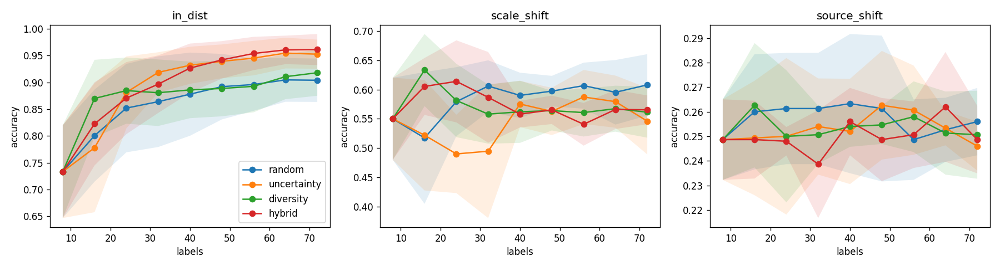

# microscopy-active-learning

A small, honest prototype: self-supervised (SimCLR-style) embeddings of synthetic
microstructure images, plus pool-based active learning on top of them, evaluated under
scale shift and instrument shift. **This is a toy pipeline, not research.** The data is
synthetic, the scale is tiny, and the results below mostly show how far this is from a real study.

## Problem

Labelling micrographs (phase, texture, defect type) needs expert time. Given a pool of unlabeled
images, which ones should be labeled first? And do the learned representations survive a change of
magnification or of instrument? This repo builds the smallest end-to-end harness that asks both questions
with seeded, reproducible runs.

## How it maps to the Jülich IAS-9 topic

The PhD topic is multi-scale, multi-modal representation learning for SEM/TEM/EBSD with active
learning / experimental design under cost and uncertainty. Here:

- **multi-scale**: contrastive training uses random-resized crops of 15-100% of the image area, and evaluation includes a magnification shift.
- **active learning under cost**: label budget is the cost; four query strategies are compared.
- **shift**: a different "instrument" (contrast, noise, blur, offset) is a stand-in for cross-source generalisation.
- **not covered**: multi-modal pairing (EBSD), property prediction, calibrated uncertainty (see Roadmap).

## Quick start

```bash
pip install torch            # CPU is fine
pip install -e ".[dev]"
pytest -q                    # 13 tests, ~8 s
python scripts/run_experiment.py                 # ~4.5 min on a laptop CPU, writes results/results.{csv,png}
python scripts/run_experiment.py --epochs 0 --tag _noprtrain   # ablation: random-init encoder
```

Layout: `src/maldl/{data,models,training,active,eval}`, `scripts/run_experiment.py`, `tests/`.
`data/folder.py` is a loader for a real image folder (e.g. UHCSDB, check its licence and download it yourself);
it is **untested on real data** and nothing is downloaded or bundled.

## Setup of the reported run

- 4 synthetic classes (fine grains, coarse grains, lamellar, precipitates), 64x64 grayscale, Voronoi grains + noise + blur.
- Pool of 600 images per seed; encoder (3-conv CNN, 128-d) trained 15 epochs with NT-Xent on the unlabeled pool; then frozen.
- Head: logistic regression on standardized embeddings. Start with 8 random labels, add 8 per round for 8 rounds (72 labels at the end).
- Strategies: `random`, `uncertainty` (max entropy), `diversity` (greedy k-center), `hybrid` (top-4b by entropy, then k-center).
- Test sets of 300 images each: `in_dist` (same generator), `scale_shift` (feature sizes x1.5), `source_shift` (low contrast, more noise, more blur, brightness offset).
- 5 seeds (0-4). Full per-round numbers: `results/results.csv`; curves: `results/results.png`; logs in `results/`.

## Results (real run, 5 seeds, mean ± std, accuracy at 72 labels; curve-mean over all rounds in parentheses)

Contrastive encoder (`results/results.csv`):

| strategy    | in_dist             | scale_shift         | source_shift        |
|-------------|---------------------|---------------------|---------------------|
| random      | 0.904±0.040 (0.858) | 0.608±0.052 (0.583) | 0.256±0.014 (0.257) |
| uncertainty | 0.953±0.027 (0.893) | 0.546±0.057 (0.545) | 0.246±0.010 (0.253) |
| diversity   | 0.918±0.043 (0.874) | 0.561±0.044 (0.571) | 0.251±0.018 (0.253) |
| hybrid      | 0.961±0.029 (0.896) | 0.565±0.025 (0.572) | 0.249±0.014 (0.250) |

Ablation, random-init encoder, no pretraining (`results/results_noprtrain.csv`):

| strategy    | in_dist             | scale_shift         | source_shift        |
|-------------|---------------------|---------------------|---------------------|
| random      | 0.917±0.024 (0.852) | 0.600±0.051 (0.584) | 0.250±0.000 (0.250) |
| uncertainty | 0.915±0.035 (0.842) | 0.631±0.028 (0.599) | 0.250±0.000 (0.250) |
| diversity   | 0.919±0.029 (0.836) | 0.552±0.046 (0.545) | 0.250±0.000 (0.250) |
| hybrid      | 0.953±0.006 (0.866) | 0.539±0.066 (0.565) | 0.250±0.000 (0.250) |



### What these numbers do and do not say

- **In-distribution:** uncertainty and hybrid beat random at 72 labels (0.953 / 0.961 vs 0.904), but the stds are 0.03-0.04 over 5 seeds, so this is suggestive, not established. Diversity is about equal to random.
- **Active learning does not help under shift.** On scale shift, random (0.608) is the best or tied-best strategy with the contrastive encoder; all three active strategies are lower. Strategies choosing informative in-distribution points do not transfer to a shifted test set.
- **Instrument shift breaks everything.** All strategies sit at ~chance (0.25 for 4 balanced classes). A classifier trained on one "instrument" does not transfer to the other, with or without pretraining. The augmentations (small contrast/brightness/noise jitter) clearly do not cover this shift; the multi-scale crops do not help here.
- **Pretraining barely matters in this setup.** The contrastive encoder is not better than a randomly initialised CNN (in-dist random-strategy: 0.904 vs 0.917; the loss only fell from ~4.85 to ~4.5 in 15 epochs). With 4 easy synthetic classes, random conv features plus logistic regression already work. The ablation shows no evidence the SimCLR stage earns its cost here; it probably needs longer training, a bigger pool, and harder data.
- No hyperparameters were tuned after seeing results; this is the first full run of the default configuration.

## Limitations

- **Synthetic data only.** Classes are defined by construction (grain count, stripes, dots) and are easy to separate; real micrographs are not like this. No real-data result exists.
- **Small scale.** 600-image pool, 64x64 images, 5 seeds, 15 pretraining epochs, a 3-layer CNN. Differences of a few points are within noise.
- **Scale shift is partly label-ambiguous by design:** a 1.5x magnified fine-grain image looks like a coarser texture, so some accuracy loss is unavoidable without scale metadata.
- **No EBSD / multi-modal data**, no orientation information.
- **No property surrogate** and no uncertainty calibration: entropy from logistic regression is uncalibrated and is not an experimental-design criterion in the Bayesian sense.
- The loader for real image folders is untested on real data.

## Roadmap

1. Real data: UHCSDB (after checking licence/availability), with proper train/test splits by sample, not by image.
2. Multi-modal: pair SEM with EBSD maps of the same region and learn a joint embedding.
3. Property surrogate: regress a mechanical/physical property from embeddings; use surrogate uncertainty for acquisition.
4. Uncertainty calibration (ensembles / temperature scaling / conformal) and cost-aware acquisition.
5. Stronger augmentation or domain-adaptation for instrument shift; longer pretraining with a fair comparison to random-init.

## License

MIT
